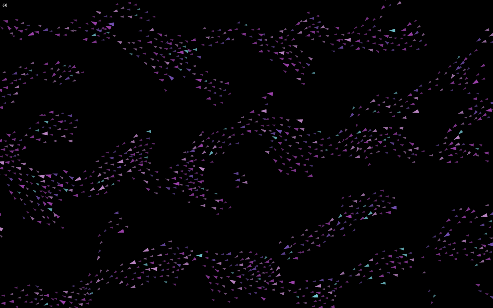

# WebGPU Boids

**Available here: https://nsimonfr.github.io/webgpu-boids/**

Initial implementation / test of https://webgpufundamentals.org/webgpu/lessons/webgpu-fundamentals.html in a project using Vite + TS.

Converted to use compute / render shaders for boids, for a more performant https://github.com/nSimonFR/wasm-boids

Flocking: Reynolds steering (separation / alignment / cohesion with capped turn rate, field of view, smooth neighbour falloff, speed band, wander and pointer avoidance), ping-pong compute buffers, frame-rate independent. Calm by design: density-based boid count, aligned spawn, fixed per-boid colours, MSAA, fade-in, and a still frame under `prefers-reduced-motion`.

